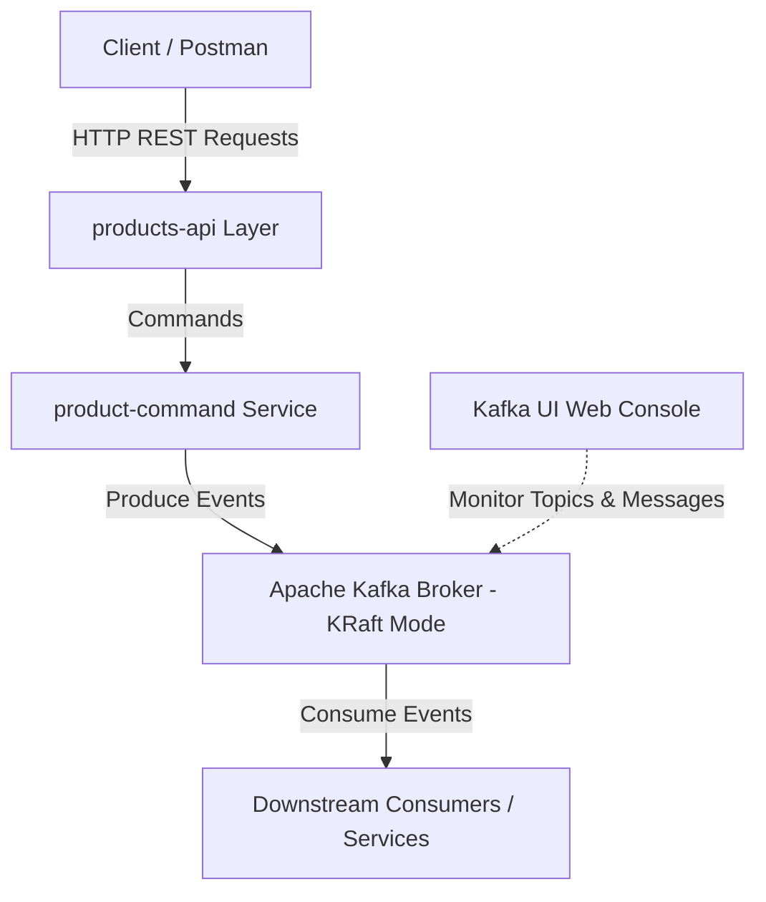

# Event-Driven Microservices Architecture with Spring Boot & Apache Kafka

[](https://openjdk.org/projects/jdk/21/)
[](https://spring.io/projects/spring-boot)
[](https://spring.io/projects/spring-cloud-stream)
[](https://kafka.apache.org/)

A production-ready reference architecture demonstrating the design and implementation of event-driven distributed microservices using modern **Java 21**, **Spring Boot 3.x**, **Spring Cloud Stream**, and **Apache Kafka in KRaft mode**.

---

## 🏛️ Architecture & System Design

This system leverages an **Event-Driven Architecture (EDA)** combined with **CQRS (Command Query Responsibility Segregation)** principles to ensure high throughput, fault tolerance, and loose coupling between domain services.



### Key Architectural Patterns & Features
* **Event-Driven Messaging:** Asynchronous event streaming powered by **Spring Cloud Stream** and **Apache Kafka**, decoupling domain operations and ensuring scalability.
* **CQRS Pattern:** Separation of command operations (`product-command`) from read/REST entry points (`products-api`) for optimal performance and clean layer boundaries.
* **Request-Reply Pattern:** Synchronous-over-asynchronous communication using correlation IDs and dedicated reply topics.
* **Apache Kafka in KRaft Mode:** Operates natively without ZooKeeper, streamlining deployment topology and reducing resource overhead.
* **Observability & Management:** Real-time stream auditing, topic inspection, and consumer group tracking integrated via **Kafka UI**.

---

## 🛠️ Technology Stack

| Category | Technology / Framework |
| :--- | :--- |
| **Language** | Java 21 |
| **Core Framework** | Spring Boot 3.x, Spring Cloud Stream |
| **Messaging & Streaming** | Apache Kafka (KRaft mode) |
| **Monitoring & GUI** | Kafka UI |
| **DevOps & Tooling** | Docker, Maven, Postman |

---

## 📁 Repository Structure

```text
spring-kafka-event-driven-architecture/
├── docs/                           # Technical specifications and RFCs
│   └── RFC-001-request-reply-pattern.md
├── services/                       # Microservice modules
│   ├── producer-service/           # Event producer and request initiator (products-api)
│   └── consumer-service/           # Event processor and domain logic handler (product-command)
└── pom.xml                         # Root Maven multi-module POM
```

---

## 🚀 Getting Started

### Prerequisites

* **Java Development Kit (JDK):** Version 21
* **Build Tool:** Maven 3.9+
* **Container Runtime:** Docker Desktop / Docker Engine

### 1. Clone the Repository
```bash
git clone https://github.com/arejmaci/spring-kafka-event-driven-architecture.git
cd spring-kafka-event-driven-architecture
```

### 2. Set Up Infrastructure (Kafka KRaft & Kafka UI)

Create a dedicated Docker network:
```bash
docker network create kafka-net
```

Generate a Cluster ID and start Kafka in KRaft mode:
*(Example for PowerShell / Windows)*
```powershell
$CLUSTER_ID = docker run --rm apache/kafka:latest /opt/kafka/bin/kafka-storage.sh random-uuid

docker run -d `
  --name kafka `
  --network kafka-net `
  -p 9092:9092 `
  -e KAFKA_NODE_ID=1 `
  -e KAFKA_CLUSTER_ID=$CLUSTER_ID `
  -e KAFKA_PROCESS_ROLES=broker,controller `
  -e KAFKA_CONTROLLER_QUORUM_VOTERS=1@kafka:9093 `
  -e KAFKA_LISTENERS=PLAINTEXT://0.0.0.0:9092,INTERNAL://0.0.0.0:19092,CONTROLLER://0.0.0.0:9093 `
  -e KAFKA_ADVERTISED_LISTENERS=PLAINTEXT://localhost:9092,INTERNAL://kafka:19092 `
  -e KAFKA_LISTENER_SECURITY_PROTOCOL_MAP=PLAINTEXT:PLAINTEXT,INTERNAL:PLAINTEXT,CONTROLLER:PLAINTEXT `
  -e KAFKA_CONTROLLER_LISTENER_NAMES=CONTROLLER `
  -e KAFKA_INTER_BROKER_LISTENER_NAME=INTERNAL `
  -e KAFKA_OFFSETS_TOPIC_REPLICATION_FACTOR=1 `
  -e KAFKA_TRANSACTION_STATE_LOG_REPLICATION_FACTOR=1 `
  -e KAFKA_TRANSACTION_STATE_LOG_MIN_ISR=1 `
  -e KAFKA_GROUP_INITIAL_REBALANCE_DELAY_MS=0 `
  apache/kafka:latest
```

(Optional) Launch **Kafka UI** for real-time monitoring on port `8085`:
```powershell
docker run -d `
  --name kafka-ui `
  --network kafka-net `
  -p 8085:8080 `
  -e KAFKA_CLUSTERS_0_NAME=local `
  -e KAFKA_CLUSTERS_0_BOOTSTRAPSERVERS=kafka:19092 `
  provectuslabs/kafka-ui:latest
```

### 3. Build & Run the Microservices

Build the entire multi-module project:
```bash
mvn clean install
```

Run the microservices independently:
* **Producer Service (`products-api`)**:
  ```bash
  cd services/producer-service
  mvn spring-boot:run
  ```
* **Consumer Service (`product-command`)**:
  ```bash
  cd services/consumer-service
  mvn spring-boot:run
  ```

---

## 📄 Technical Documentation

* **[RFC-001: Request-Reply Pattern Implementation](./docs/RFC-001-request-reply-pattern.md)**: Detailed specification and sequence diagrams covering the request-reply pattern implementation using Spring Cloud Stream and Kafka.

---

## 🤝 Contributing

Contributions, feedback, and issue reports are welcome. Feel free to open a pull request or submit an issue.

## 📝 License

Distributed under the MIT License. See `LICENSE` for details.
