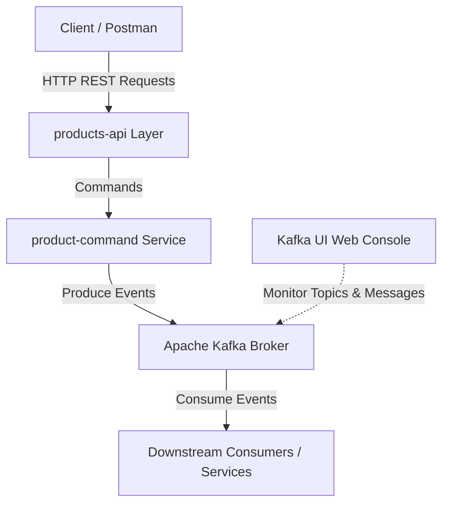

# Event-Driven Microservices Architecture with Spring Boot & Apache Kafka

A production-ready reference architecture demonstrating the design and implementation of event-driven distributed microservices using modern Java, Spring Boot 4, Spring Cloud Stream, and Apache Kafka.

---

## 🏛️ Architecture & System Design

This system leverages an **Event-Driven Architecture (EDA)** combined with **CQRS (Command Query Responsibility Segregation)** principles to ensure high throughput, fault tolerance, and loose coupling between domain services.



### Key Architectural Patterns & Features
* **Event-Driven Messaging:** Asynchronous event streaming powered by **Spring Cloud Stream** and **Apache Kafka**, decoupling domain operations and ensuring scalability.
* **CQRS Pattern:** Separation of command operations (`product-command`) from read/REST entry points (`products-api`) for optimal performance and clean layer boundaries.
* **Clean Architecture & DTOs:** Strict boundary separation between domain entities and external interfaces using **Data Transfer Objects (DTOs)** and validation layers.
* **ORM & Relational Persistence:** Data persistence and mapping managed through **Spring Data JPA** and **Hibernate**.
* **Observability & Management:** Real-time stream auditing, topic inspection, and consumer group tracking integrated via **Kafka UI**.
* **Containerized Infrastructure:** One-click environment provisioning with **Docker & Docker Compose**.

---

## 🛠️ Technology Stack

| Category | Technology / Framework |
| :--- | :--- |
| **Language** | Java 17 / 21 |
| **Core Framework** | Spring Boot 3.x / 4.x, Spring Framework |
| **Messaging & Streaming** | Apache Kafka, Spring Cloud Stream |
| **Monitoring & GUI** | Kafka UI |
| **Persistence & ORM** | Spring Data JPA, Hibernate, MySQL |
| **DevOps & Tooling** | Docker, Docker Compose, Maven, Postman |

---

## 📁 Project Structure

```text
├── product-command                 # Domain microservice handling write commands & publishing Kafka events
├── products-api                    # REST API layer exposing controllers, request validation, and DTO mappings
├── docker-compose.yml              # Local infrastructure stack (Kafka broker, Zookeeper/KRaft, Kafka UI)
├── gu_a_paso_a_paso_de_testing.md  # Detailed step-by-step verification guide
└── README.md                       # Technical documentation and architecture blueprint
```

---

## 🚀 Getting Started

### Prerequisites

* **Java Development Kit (JDK):** Version 17 or higher
* **Build Tool:** Maven 3.8+
* **Container Runtime:** Docker Desktop / Docker Engine & Docker Compose
* **Database:** MySQL 8.x running locally on port 3306

### Local Infrastructure Setup

1. **Clone the repository:**
   ```bash
   git clone https://github.com/arejmaci/spring-kafka-event-driven-architecture.git
   cd spring-kafka-event-driven-architecture
   ```

2. **Spin up the messaging infrastructure:**
   ```bash
   docker-compose up -d
   ```
   *This starts the Apache Kafka broker along with Kafka UI for message management.*

3. **Access Kafka UI:**
   Open your browser and navigate to `http://localhost:8080` (or your configured port) to inspect Kafka topics and active brokers.

4. **Build and test the application modules:**
   ```bash
   mvn clean install
   ```

---

## 🧪 End-to-End Testing & Verification

To verify the complete event-driven flow across all layers (Postman -> REST API Producer -> Kafka Input Topic -> Microservice Consumer -> MySQL Persistence -> Kafka Output Topic), execute the **4-Terminal Execution Pattern**:

### 1. Terminal Layout Strategy

* **Terminal 1 (Kafka Consumer - Input Topic `product-commands`):**
  Monitor raw incoming creation commands published by `products-api`:
  ```bash
  docker exec -it kafka kafka-console-consumer --bootstrap-server localhost:9092 --topic product-commands --from-beginning
  ```

* **Terminal 2 (Kafka Consumer - Output Topic `product-replies`):**
  Monitor execution response events produced by `product-command`:
  ```bash
  docker exec -it kafka kafka-console-consumer --bootstrap-server localhost:9092 --topic product-replies --from-beginning
  ```

* **Terminal 3 (Microservice - `product-command`):**
  Start the domain consumer service (runs on port `8081`):
  ```bash
  cd product-command
  ./mvnw.cmd clean spring-boot:run
  ```

* **Terminal 4 (Microservice - `products-api`):**
  Start the REST producer service (runs on port `8080`):
  ```bash
  cd products-api
  ./mvnw.cmd clean spring-boot:run
  ```

---

### 2. Postman Request & Payload Sample

Send a `POST` request to `http://localhost:8080/products` via Postman:

**Headers:**
`Content-Type: application/json`

**Body:**
```json
{
    "name": "Teclado inalambrico",
    "price": 2530
}
```

---

### 3. Real-Time Execution Trace & Verification

* **HTTP Response (`products-api`):**
  ```json
  {
      "message": "Product creation command sent successfully"
  }
  ```

* **Terminal 1 (`product-commands` Topic):**
  ```json
  {"type":"CREATE","id":null,"body":{"name":"Teclado inalambrico","price":2530.0}}
  ```

* **Terminal 2 (`product-replies` Topic):**
  ```json
  {"status":"SUCCESS","message":"Created Product","body":{"id":4,"name":"Teclado inalambrico","price":2530.0}}
  ```

* **Database Verification (MySQL `db_spring_kafka.product`):**
  ```sql
  SELECT * FROM product;
  ```
  | id | name | price | created_at | updated_at |
  | :--- | :--- | :--- | :--- | :--- |
  | **4** | **Teclado inalambrico** | **2530** | `2026-10-25 11:00:02` | `2026-10-25 11:00:02` |

For step-by-step commands, refer to the [Testing Guide](gu_a_paso_a_paso_de_testing.md).

---

## 🤝 Contributing

Contributions, feedback, and issue reports are welcome. Feel free to open a pull request or submit an issue.

## 📄 License

Distributed under the MIT License. See `LICENSE` for more information.