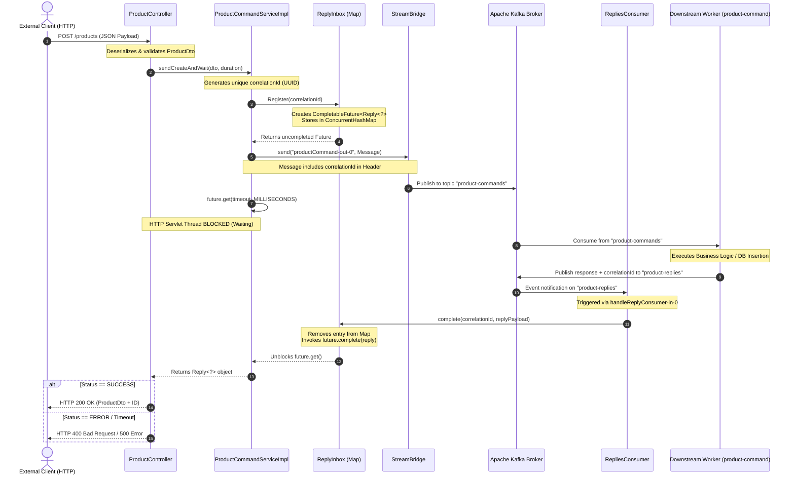

# RFC-001: Async Request-Reply Pattern over Kafka via Spring Cloud Stream

- **Status**: Standard / Approved
- **Author**: Technical Architecture Team
- **Date**: October 2026
- **Target Subsystem**: `products-api` & `product-command`
- **Scope**: Inter-service Communication & Synchronous-to-Asynchronous Bridging

---

## 1. Abstract

This document defines the architectural standard for implementing the **Asynchronous Request-Reply Pattern** using Spring Cloud Stream and Apache Kafka. The primary goal is to provide a non-blocking, event-driven integration layer that decouples microservices at the network layer while exposing a synchronous RESTful API interface to external clients.

---

## 2. Problem Statement & Objectives

### 2.1 Problem
External clients (frontends, third-party consumers) require immediate, deterministic HTTP responses when initiating state-changing actions (e.g., `POST /products` returning HTTP 200 with the database-generated ID). However, direct HTTP/REST service-to-service communication introduces strong coupling, tight availability dependencies, and lack of built-in backpressure.

### 2.2 Objectives
1. **Decouple Components**: Eliminate the need for Service Discovery (Eureka) for core business flows by communicating strictly via Kafka topics.
2. **Bridge Synchronous & Asynchronous Paradigms**: Hold the incoming HTTP servlet thread in a controlled wait state using `CompletableFuture` while message processing occurs asynchronously across the broker.
3. **Resilience**: Ensure command persistence in Kafka during downstream consumer degradation.

---

## 3. Architecture & System Components

The system consists of the following internal components operating within the `products-api` service boundary:

| Component | Layer / Responsibility |
| :--- | :--- |
| **`ProductController`** | REST Controller handling client payload validation (`@Valid`) and mapping HTTP responses. |
| **`ProductCommandServiceImpl`** | Domain service orchestrating message construction, header injection (`correlationId`), and execution dispatching. |
| **`StreamBridge`** | Spring Cloud Stream infrastructure bridge sending payload events to the broker. |
| **`ReplyInbox`** | Stateful, thread-safe in-memory registry (`ConcurrentHashMap<String, CompletableFuture<Reply<?>>>`) for correlation tracking. |
| **`RepliesConsumer`** | Spring Cloud Function bean (`Consumer<Message<Reply<?>>>`) configured to listen to Kafka reply topics. |

---

## 4. End-to-End Sequence Diagram

The following sequence diagram outlines the exact flow of execution, thread states, and event propagation across the system boundary:



---

## 5. Key Design Principles & Data Contracts

### 5.1 Correlation Tracking
Every outbound command message is injected with a transient metadata header:
- **Header Name**: `correlationId`
- **Format**: Standard UUID v4 (`java.util.UUID.randomUUID()`)

The correlation ID acts as the join key bridging the asynchronous Kafka reply with the suspended HTTP thread.

### 5.2 Message Envelopes
All domain messages are wrapped in standard record structures to preserve immutability:

1. **Outbound Command**: `Command<T>(String type, Long id, T body)`
2. **Inbound Reply**: `Reply<T>(String status, String message, T body)`

### 5.3 Memory Hygiene & Concurrency
- `ReplyInbox` utilizes `ConcurrentHashMap` to guarantee thread safety during atomic removal operations (`remove(correlationId)`).
- Futures are purged immediately upon completion to avoid memory leaks.
- A client-specified timeout (e.g., 5 seconds) guards against unbounded thread blockage in the event of missing or dropped Kafka replies.

---

## 6. Spring Cloud Stream Configuration Matrix

To bind functional Java beans to underlying Kafka topics without boilerplate code, the following configuration bindings are declared in `application.properties`:

```properties
# Outbound Binding
spring.cloud.stream.bindings.productCommand-out-0.destination=product-commands
spring.cloud.stream.bindings.productCommand-out-0.content-type=application/json

# Inbound Functional Consumer Binding
spring.cloud.function.definition=handleReplyConsumer
spring.cloud.stream.bindings.handleReplyConsumer-in-0.destination=product-replies
spring.cloud.stream.bindings.handleReplyConsumer-in-0.content-type=application/json
spring.cloud.stream.bindings.handleReplyConsumer-in-0.group=product-api
spring.cloud.stream.kafka.bindings.handleReplyConsumer-in-0.consumer.start-offset=latest
```

---

## 7. Trade-offs & Operational Guidelines

### 7.1 Benefits
- **Zero Service Discovery Dependency**: No Eureka required.
- **High Resilience**: Kafka acts as a persistent buffer during spikes or consumer downtime.
- **Clean Separation of Concerns**: Controllers handle HTTP contracts; services handle asynchronous messaging primitives.

### 7.2 Considerations
- **Memory Consumption**: High volume under peak loads increases temporary heap footprint for uncompleted futures.
- **Timeout Management**: Timeouts must be tuned carefully to match SLAs and downstream database insertion capabilities.